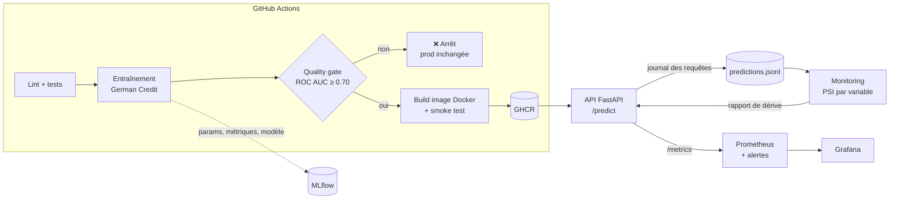

# 🏭 MLOps Pipeline — Credit Risk, du notebook à la production

Pipeline MLOps **de bout en bout** autour d'un modèle de risque de crédit :
entraînement reproductible et tracé, **quality gate** qui bloque les mauvais modèles,
API conteneurisée publiée automatiquement par la CI/CD, **monitoring** Prometheus/Grafana
et **détection de dérive** des données en production.


## Le problème

Un modèle qui marche dans un notebook n'est pas un produit. En production, il faut pouvoir répondre à :
*quel modèle tourne, entraîné sur quoi, avec quels résultats ? Est-ce qu'un nouveau modèle est meilleur ?
Est-ce que les données d'aujourd'hui ressemblent encore à celles d'entraînement ?*
Ce projet répond à chacune de ces questions par du code, pas par des manipulations manuelles.

## Architecture



## Ce que montre le projet

| Brique | Implémentation |
|---|---|
| **Reproductibilité** | Tous les paramètres dans `params.yaml`, graines fixées, prétraitement et modèle dans un seul `Pipeline` scikit-learn (pas d'écart entraînement/production). |
| **Traçabilité** | Chaque run MLflow enregistre paramètres, métriques, commit git, signature et modèle. |
| **Quality gate** | Le modèle est entraîné dans `models/candidate/` et n'est promu en production que si la ROC AUC dépasse le seuil. Un modèle refusé ne remplace jamais celui en place (testé). |
| **Validation des données** | Schéma vérifié à l'entraînement ; entrées de l'API validées par Pydantic (âge ≥ 18, montants ≥ 0, champs obligatoires). |
| **CI/CD** | Lint → tests → entraînement sur données réelles → build Docker → smoke test du conteneur → publication sur GitHub Container Registry. |
| **Observabilité** | Compteurs, latence et distribution des scores exposés pour Prometheus ; tableau de bord Grafana provisionné automatiquement. |
| **Détection de dérive** | PSI (Population Stability Index) par variable. Alerte si trop de variables dérivent **ou** si une variable critique dérive. Rapport HTML Evidently en option. |
| **Alerting** | Règles Prometheus : dérive, latence p95 > 250 ms, erreurs de prédiction. |

## Démarrage rapide

```bash
git clone https://github.com/abderrahimseddiki/mlops-pipeline.git
cd mlops-pipeline
python -m venv .venv
source .venv/bin/activate        # Windows : .venv\Scripts\activate
pip install -r requirements-dev.txt
```

Sous Linux/macOS, `export PYTHONPATH=src` ; sous Windows PowerShell, `$env:PYTHONPATH="src"`.

```bash
python -m credit_risk.train           # télécharge les données, entraîne, applique le quality gate
mlflow ui --backend-store-uri sqlite:///mlflow.db   # http://localhost:5000
uvicorn credit_risk.serve:app         # http://localhost:8000/docs
```

### Démo de la détection de dérive

Dans un second terminal, l'API tournant :

```bash
python -m credit_risk.simulate --n 200          # trafic normal
python -m credit_risk.monitor                   # → pas de dérive
python -m credit_risk.simulate --n 200 --drift  # la population change
python -m credit_risk.monitor --html            # → ALERTE + rapport HTML (code de sortie 2)
```

### Stack complète avec Docker

Après un premier `python -m credit_risk.train` :

```bash
docker compose up --build
```

| Service | URL |
|---|---|
| API (Swagger) | http://localhost:8000/docs |
| MLflow | http://localhost:5000 |
| Prometheus | http://localhost:9090 |
| Grafana | http://localhost:3000 (tableau de bord « Credit Risk — Production ») |

## Résultats

Jeu de données : [German Credit (OpenML `credit-g`)](https://www.openml.org/d/31) — 1000 demandes, 20 variables, 30 % de mauvais payeurs.

> ⏳ À compléter avec les chiffres du premier entraînement réel (visibles aussi dans le résumé du job « Train » de la CI).

| Modèle | ROC AUC (test) | ROC AUC (CV 5 folds) | F1 | Recall |
|---|---|---|---|---|
| Gradient Boosting | – | – | – | – |
| Logistic Regression | – | – | – | – |

| Pipeline | Mesure |
|---|---|
| Durée CI/CD complète (push → image publiée) | – |
| Latence p95 de `/predict` | – |

## Structure

```
src/credit_risk/
├── config.py     # chemins + params.yaml
├── data.py       # téléchargement, validation du schéma, découpage
├── model.py      # Pipeline prétraitement + modèle
├── train.py      # entraînement, MLflow, quality gate, promotion
├── serve.py      # API FastAPI + métriques Prometheus
├── drift.py      # PSI et règle d'alerte (testés)
├── monitor.py    # job de monitoring (+ rapport Evidently)
└── simulate.py   # générateur de trafic, avec ou sans dérive
docker/           # Prometheus (scrape + alertes), Grafana (datasource + dashboard)
tests/            # 21 tests : données, modèle, gate, API, dérive
```

## Limites et pistes

- La vraie étiquette (le client a-t-il remboursé ?) arrive des mois plus tard : on surveille donc la dérive
  des **entrées**, pas directement la performance. Piste : joindre les étiquettes tardives pour suivre l'AUC réelle.
- Promotion via fichiers ; piste : MLflow Model Registry avec alias `champion` / `challenger`.
- Les données German Credit contiennent des variables sensibles (âge, statut personnel) : un vrai déploiement
  demanderait un audit d'équité.

## Auteur

**Abderrahim Seddiki** — [GitHub](https://github.com/abderrahimseddiki)
